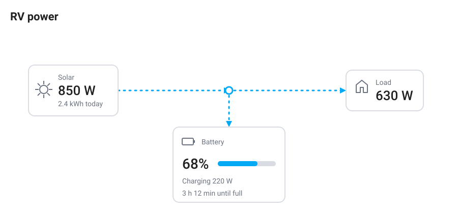

# Off-grid Power Card

A responsive Home Assistant dashboard card for a solar source, one battery, and calculated electrical consumption. It presents current power flow, battery state of charge, optional remaining time, and optional daily solar yield without querying history.



## Install with HACS

[](https://my.home-assistant.io/redirect/hacs_repository/?owner=jbergler&repository=hass-offgrid-power-card&category=plugin)

Until the card is included in the default HACS catalog, add it as a custom repository:

1. Open **HACS → Dashboard**.
2. Open the three-dot menu and select **Custom repositories**.
3. Add `https://github.com/jbergler/hass-offgrid-power-card` with category **Dashboard**.
4. Select **Off-grid Power Card**, choose **Download**, then reload Home Assistant in the browser.

HACS installs and updates the card resource automatically from published GitHub releases.

### Manual installation

1. Run `npm install && npm run build`.
2. Copy `dist/hass-offgrid-power-card.js` to Home Assistant's `config/www/` directory.
3. Add `/local/hass-offgrid-power-card.js` as a JavaScript module under **Settings → Dashboards → Resources**.
4. Add the card with YAML configuration.

## Configuration

```yaml
type: custom:offgrid-power-card
title: RV power
solar_power_entity: sensor.rv_solar_power
solar_energy_today_entity: sensor.rv_solar_energy_today
battery:
  soc: sensor.rv_battery_state_of_charge
  power: sensor.rv_battery_power
  power_positive: discharging
  time_remaining: sensor.rv_battery_remaining_minutes
flow_rate_threshold: 5
max_power: 3000
transparent: true
```

| Key | Required | Default | Meaning |
|---|---:|---|---|
| `solar_power_entity` | Yes | — | Current solar production; power sensor using mW, W, kW, or MW |
| `battery.soc` | Yes | — | Battery state of charge in percent |
| `battery.power` | Yes | — | Signed battery power; power sensor using mW, W, kW, or MW |
| `solar_energy_today_entity` | No | Hidden | Today's solar yield; energy sensor using mWh, Wh, kWh, or MWh |
| `battery.time_remaining` | No | Hidden | Remaining time; duration sensor using ms, s, min, h, or d |
| `battery.power_positive` | No | `discharging` | Meaning of a positive battery-power value: `discharging` or `charging` |
| `flow_rate_threshold` | No | `5` | Absolute power in watts below which animation stops |
| `max_power` | No | `3000` | Power in watts represented by maximum pulse density |
| `title` | No | Hidden | Optional card heading |
| `transparent` | No | `false` | Remove the outer card background, border, and shadow while retaining the node boxes |
| `solar_label`, `battery_label`, `load_label` | No | Solar, Battery, Load | Node labels |
| `solar_icon`, `battery_icon`, `load_icon` | No | Matching MDI icons | Node icon overrides |

When a compatible `device_class` is present, the card validates it. Template sensors without a device class remain supported when their units are compatible.

## Electrical model

With the default positive-discharge convention:

```text
calculated load = solar power + battery power
```

Battery charging is represented by negative battery power. If `battery.power_positive: charging` is selected, the card normalizes that sign before calculating load.

Solar and battery feed a central power bus; the battery connection reverses direction while charging. Negative solar or calculated load values remain visible but stop the affected animation and receive a warning indicator. Unknown, unavailable, malformed, or dimensionally incompatible values appear as `—` only where affected.

## Display behavior

- The diagram keeps a landscape topology at every width; narrow containers tighten node widths and hide optional details before allowing overlap.
- Height follows card width at a 36:17 aspect ratio, with a 184 px minimum and a 360 px/viewport-aware maximum.
- Solar power appears in the node heading, with daily yield on a full-width second row.
- Power uses W below 1,000 W and kW at or above 1,000 W.
- Calculated consumption uses whole watts below 1 kW and one decimal place in kW.
- Remaining time uses localized full unit names such as `3 days, 23 hours remaining`.
- Flow pulses use a constant segment length; spacing represents power relative to `max_power`.
- Static arrowheads preserve direction when reduced-motion preferences disable animation.
- Optional details are progressively hidden in very narrow containers.
- Sections dashboards use full width with automatic row height instead of a fixed grid-row count.
- The card inherits Home Assistant colors, typography, card shape, and dark/light theme variables.
- Select Solar or Battery to open Home Assistant's more-info dialog for solar power or battery state of charge; both nodes support keyboard activation.

## Development

```sh
npm install
npm test
npm run typecheck
npm run dev
npm run build
```

The development page renders both wide and tall fixtures with mocked Home Assistant state.

## Releasing

1. Update the package version and changelog, then push the release commit to `main`.
2. Wait for the **Validate** workflow, including HACS validation, to pass.
3. Create and push a matching semantic-version tag such as `v0.1.0`.

The **Release** workflow reruns tests, builds `dist/hass-offgrid-power-card.js`, and creates a published GitHub Release with that file attached for HACS.
